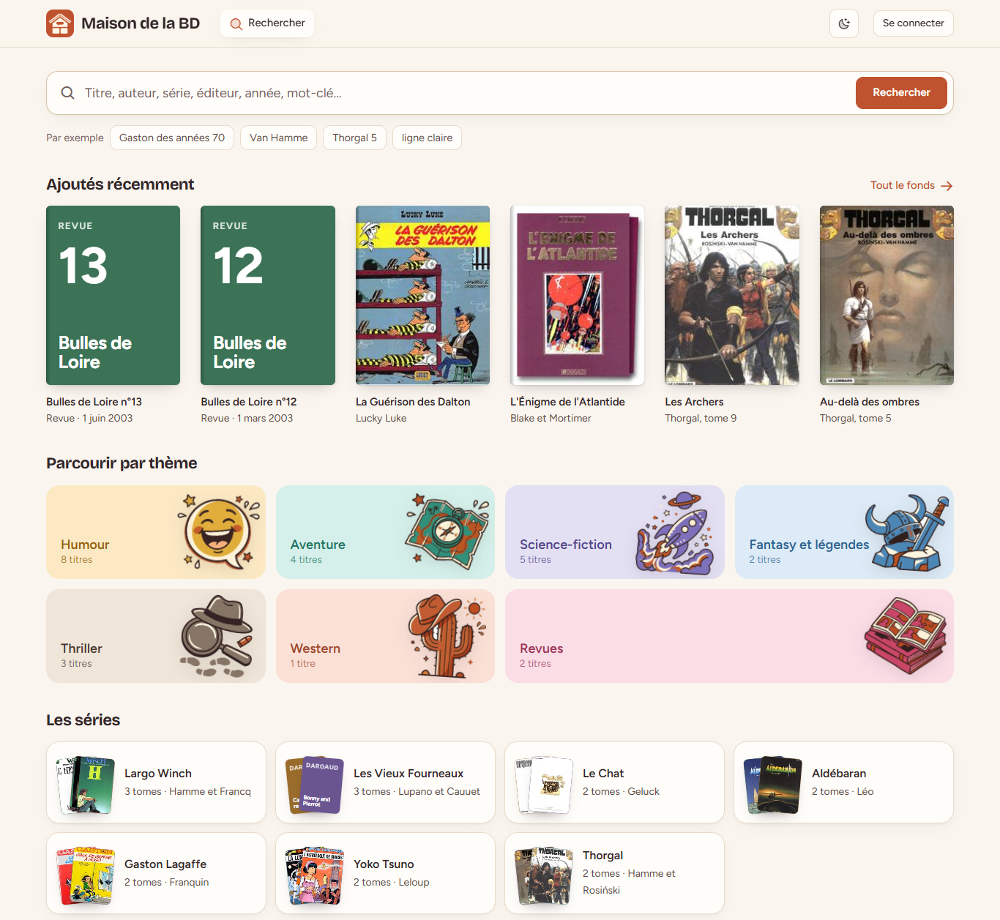

# Maison de la BD

Application web locale pour archiver, gérer et consulter le fonds d'albums et de revues de la Maison de la Bande Dessinée de Blois. Projet SAE, BUT 2 Informatique.



## État

Prototype fonctionnel en HTML, CSS et JS (`prototype/`) : il fixe les parcours et la direction artistique. L'application finale sera en Rust (Axum, sqlx, PostgreSQL, Askama, htmx).

## Lancer le prototype

Prérequis : Python 3.

```bash
python -m http.server 8765 --directory prototype
```

Ouvrir http://localhost:8765. Pour tester l'espace équipe, cliquer sur « Espace équipe » et choisir un profil : aucune vraie authentification dans le prototype. Les données sont stockées dans le navigateur.

## Captures automatiques

```bash
pip install playwright
python .claude/capturer.py
```

Capture chaque écran en 1366 x 768 dans `.claude/captures/`, en clair et en sombre, et signale les erreurs JavaScript. Le serveur ci-dessus doit tourner.

## Arborescence

| Dossier | Contenu |
|---|---|
| `prototype/` | le prototype (index, app, données, styles, assets) |
| `design/` | personas et direction artistique |
| `outils/` | script de récupération de notices sur Open Library |
| `sujet/` | sujet officiel de la SAE |
| `docs/` | captures pour la documentation |
